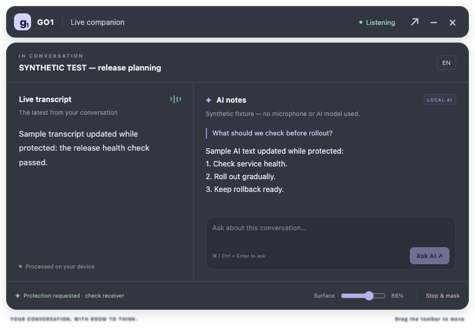
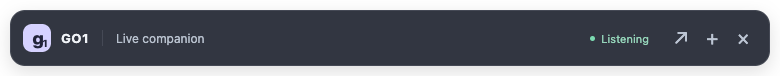
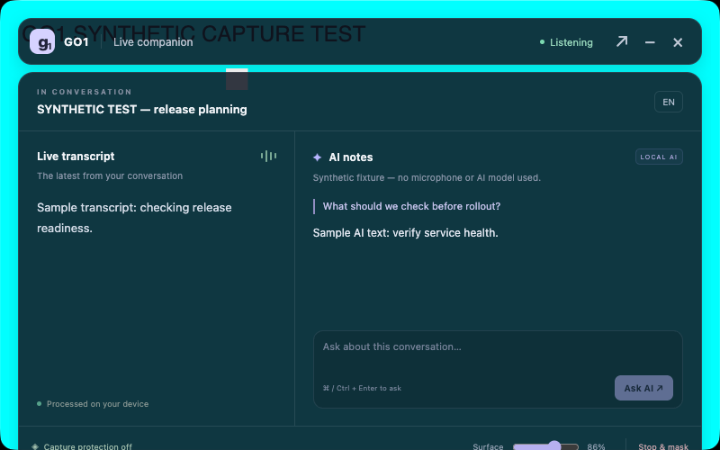
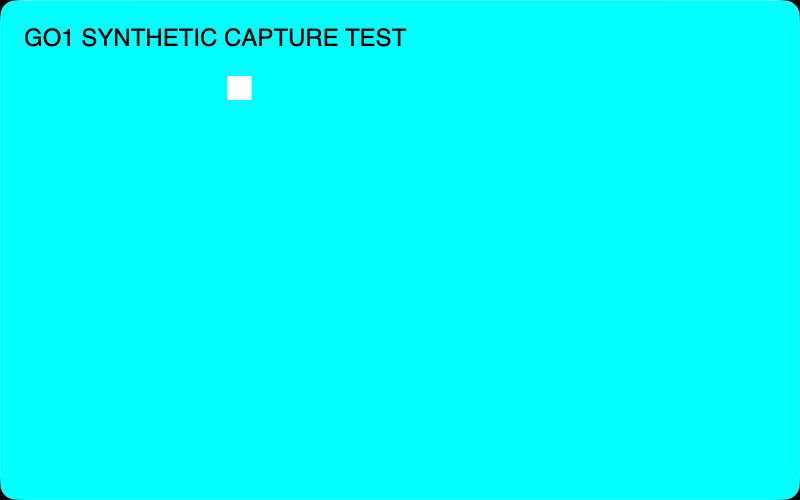

# Floating companion and the GO Client window study

## What the attached GO Client actually does

The input is GO Client 2.0.11 ARM64, with DMG SHA-256 `059ff75f28b7604966a800493c3c05c52aeebdf28ee1ccafed28a39e5c7a3b54`. The [original static evidence index](evidence/go-client-2.0.11-static.json) records bundle identities. The observations below are from its extracted `out/main/index.js`, not marketing claims.

| Mechanism found | Location in extracted main bundle | What it does |
| --- | --- | --- |
| Content protection defaults on | 17836–17837 | Sets the application's default capture-protection preference |
| `setContentProtection(preference)` | 18718; setter 18808–18813 | Requests exclusion from supported OS capture paths |
| Initial toolbar 810 × 40, top-centred | 17816–17823; 18597–18610 | Opens a small floating toolbar and later changes its layout |
| Frameless transparent window, no shadow | 18613–18622 | Removes normal window chrome and permits translucent/transparent rendering |
| Mac `panel`, always on top | 18620–18623; 18712 | Produces a floating Mac panel; the screen-saver window level controls stacking |
| All workspaces/fullscreen visibility | 18713–18716 | Keeps the panel available across Spaces/fullscreen contexts |
| `backgroundThrottling: false` | 18629 | Avoids deliberately throttling renderer timers/animations when backgrounded |
| Focused show versus `showInactive()` | 17949–17965 | Separates explicit interaction from showing without taking focus |
| Accessory activation policy and Dock hiding | 27503–27515 | Changes app/Dock presentation; separate from capture exclusion |
| Mouse passthrough | 19083–19096 | Routes pointer input through the window; separate from capture exclusion |

The crucial distinction is **capture protection versus appearance**. A transparent window may still appear in a shared stream. A protected opaque window may be omitted by a supported capture path. Moving a window above other windows does not make it invisible: GO1's unprotected high-level panel was visible in our controlled capture tests.

On macOS, Electron implements content protection using the native window sharing setting. Electron warns that ScreenCaptureKit can still capture protected windows. [Electron's documented behavior](https://www.electronjs.org/docs/latest/api/browser-window#winsetcontentprotectionenable-macos-windows). The observed GO Client calls do not prove a universal exception to that limitation. The original proprietary app has not been run in a meeting during this task; its bundled native module was inspected statically, not exhaustively disassembled.

Transcription/AI are a separate processing pipeline. Setting a window's capture flag does not stop audio capture, speech recognition or AI requests. GO1 keeps them running in live protection mode. Its emergency Stop & mask intentionally cancels them.

Parakeet's [public technical overview](https://www.parakeet-ai.com/private) describes an OS-level capture-exclusion switch and separate window/focus behavior; it also mentions a Zoom capture setting. This is a vendor description, not verification of Parakeet's implementation or of GO1. No Parakeet binary was supplied or inspected. GO1's UI is independently implemented and uses no proprietary code or artwork.

## GO1 v0.18 changes

Previously, GO1's native Mac window allowed transparency, but `html`, `body` and the content container painted an opaque background. Whole-window opacity also faded the text. The redesigned companion uses:

- Transparent HTML/body with rounded translucent surfaces, while the native window and text stay at full opacity.
- A surface slider from 58–100%, defaulting to 86%. This changes readability/appearance, not the capture-protection flag.
- A draggable toolbar and two-column transcript/AI layout, with contained scroll regions instead of a full-panel scrollbar.
- A compact 76-point toolbar mode. Expanding clamps the window to the display's work area, including negative-origin secondary displays.
- Direct question entry and an **Ask AI** button, plus Command/Ctrl+Enter. Requests use the same guarded local AI pipeline as the workspace, and require the session's AI option.
- A small protection-status disclosure instead of a large warning block occupying the reading area.
- Closing/reopening the companion preserves the active session and current question. Stop & mask still clears session content and cancels work.

Launch opens the floating companion near the top of the primary display after the live session starts. The workspace remains available through the toolbar's arrow button. Compact/expanded state and surface opacity are retained while the app runs; they are not saved across app restarts.

On narrow displays the panel prioritizes AI notes; the full transcript remains available in the workspace. macOS and Windows use frameless transparent window options; only macOS uses the native panel type. Windows visual/capture behavior needs separate native testing.

## Verification scope

Tested commit: [`6d47f59019003e8216be067fbfb0b4037a7d05a9`](https://github.com/amey1234444/GO1/commit/6d47f59019003e8216be067fbfb0b4037a7d05a9). [Native capture/renderer workflow](https://github.com/amey1234444/GO1/actions/runs/44983604658). [Download the unsigned Apple Silicon v0.18.0 DMG](https://github.com/amey1234444/GO1/actions/runs/44983604667/artifacts/14739096904), available until 6 December 2026.

Both macOS 15.8.2 and 26.7.2 completed the expanded/compact controls and transparency checks with Electron 39.8.10. Computed HTML/body backgrounds were transparent; the 70% surface was `rgba(17, 22, 34, 0.7)`; text opacity was `1`. The PNG surface sample at (40, 100) had alpha 219/255 at the default 86%, and 179/255 at 70%. This verifies real surface alpha, not merely a darker solid colour. Both controlled marker experiments returned `excluded-in-tested-paths`; that is scoped to the tested ScreenCaptureKit paths, not all meeting apps.

## Actual UI screenshots

These unmodified macOS 26 images come from the real companion renderer, with explicitly labelled synthetic transcript/AI text. They are not design mockups, real model inference, or Google Meet receiver screenshots. Transparent PNGs may look opaque when a viewer composites them onto a dark background.

Expanded companion, default 86% surface opacity:

Compact toolbar, after clicking its collapse control:

[70% surface PNG](evidence/glass-companion/macos-26/companion-live/sender-translucent.png). To show actual desktop compositing, the following **unprotected control** captures the panel over a cyan presentation fixture; the cyan is visible through the surface. It is deliberately labelled unprotected and does not demonstrate receiver invisibility:

With protection enabled, the observer's refreshed stream captured the presentation rectangle without the panel:

Complete reports: [macOS 26](evidence/glass-companion/macos-26/report.json), [macOS 15](evidence/glass-companion/macos-15/report.json). [SHA-256 provenance manifest](evidence/glass-companion/manifest.json). The reports retain all trials, including the unprotected controls and screenshot/stream differences. This is an unsigned evidence record, not independent certification.

## Limits of the checks

99 automated tests pass, including protection-independent processing, direct companion AI routing, restricted IPC origins, close/reopen state, opacity bounds and display geometry. The Mac renderer experiment additionally clicks the real compact/expand and surface controls through the restricted preload, checks transparent body/70% surface/opaque text, and saves real app-content images.

The screenshot host supplies fixture IPC handlers; the production main-process handlers are exercised by the integration tests. These checks complement each other and do not represent an end-to-end meeting with real speech recognition and model inference.

Capture checks use an independent ScreenCaptureKit observer with synthetic fixture content. They do not establish actual Google Meet/Teams/Zoom receiver invisibility. The [two-device meeting procedure](LIVE_PROTECTION_AND_MEET.md#google-meet-actual-two-device-acceptance-test) remains required for that claim.
