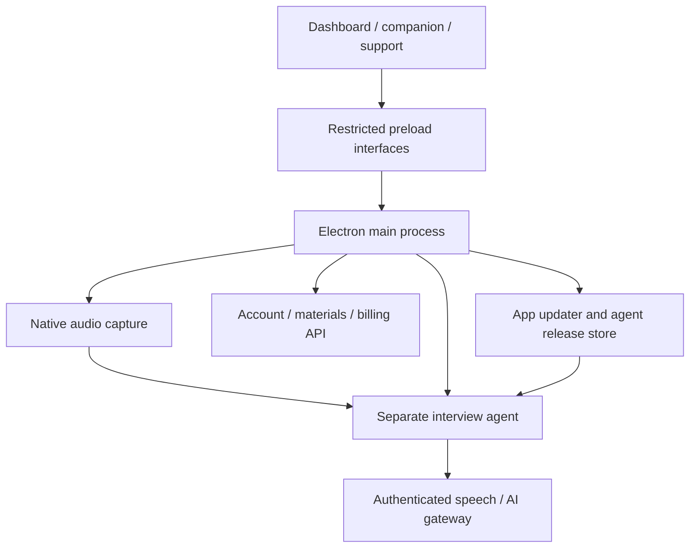
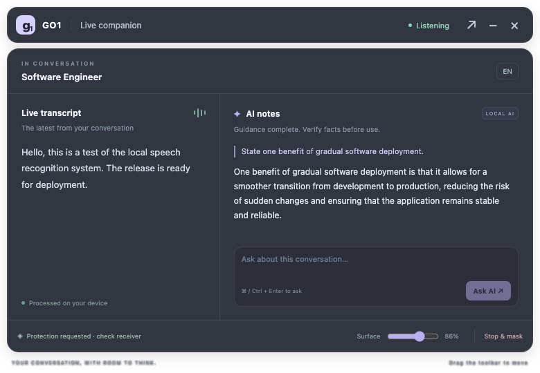
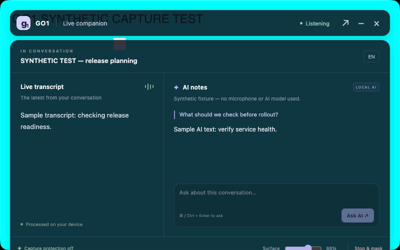
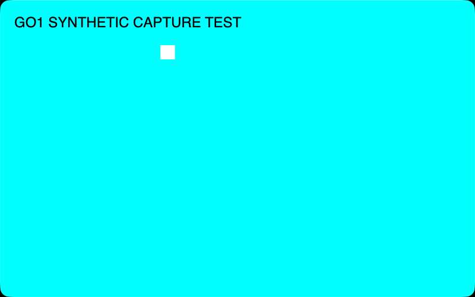

# GO Client 2.0.11: package study and GO1 implementation map

Study date: 23 November 2026, India time. GO1 implementation: v0.21.0.

## Scope and confidence

The supplied `GO_Client-2.0.11-arm64(2).dmg` has SHA-256 `059ff75f28b7604966a800493c3c05c52aeebdf28ee1ccafed28a39e5c7a3b54`. The app identifies itself as GO Client 2.0.11, build 2.0.11.1448, bundle `com.imf.greatofferai`, with Electron 43.3.0. This study combines a full extracted-file inventory with targeted review of the application subsystems, preload interfaces, bundled agent, renderer and native-module interfaces. It does **not** claim semantic review of every dependency line or disassembly of every native instruction.

- **Measured:** 10,471 inventory entries: 10,457 regular files and 14 symlinks, across two views (the extracted app bundle and extracted ASAR). These views deliberately overlap: the app inventory includes `app.asar`, and the ASAR inventory lists its extracted contents. There are 9,496 extracted ASAR files and 272 named/versioned dependency manifests, including nested packages.
- **Indexed:** dashboard preload has 92 IPC channel declarations, assistant preload 81, support preload 6. These are declarations, including event channels and overlaps between bridges, not 179 distinct user features.
- **Verified:** the bundled agent's actual SHA-256 and size match its embedded manifest. Three Electron code/string section fingerprints match the official runtime; full framework hashes differ. See [v0.20 native audit](GO_CLIENT_STEALTH_AUDIT_V020.md).
- **Not executed:** the original app, its authentication/payment services, remote agent releases and live customer workflows. Native framework imports show dependencies, not proof that every path runs on every machine.
- **Not established:** universal capture exclusion, proctoring compatibility, current server-side model routing, production latency, pricing or full GO1 feature parity.

Evidence: [readable package audit](evidence/package-audit-v021/go-client-package-audit-v021.json), [complete file/hash inventory, gzip JSONL](evidence/package-audit-v021/go-client-files-v021.jsonl.gz), [read-only inventory script](research/inventory-go-client.py). No recovered proprietary source, native binary, branding asset, credential or model weight is redistributed.

## Architecture found in the package



The renderer is a React 19 application with Radix UI components, Zustand state, i18next localization, Markdown/math rendering and Shiki syntax highlighting. Electron preloads expose named operations; the renderer does not directly own native capture or credentials. The main process coordinates windows, permissions, account state, files and diagnostics. A separate agent process owns the conversation and AI pipeline.

### The DMG is not the complete production service

`out/agent/manifest.json` identifies bundled agent version **1.0.13** and its compatibility/storage/protocol versions. `out/main/agent-bootstrap.js` checks size and SHA-256 before loading an agent bundle. `AgentReleaseStore` supports downloaded releases, atomic selection records and conversation pins. Production initialization supplies a remote `latest.json` URL. The agent running after an update can therefore differ from the agent shipped in this DMG.

The bundled policy contains identifiers for realtime transcription, dialogue decisions, draft/final answers and screenshot answers. They are retained in `bundledProfileLiterals` in the JSON report. **These strings are configuration evidence, not verified backend model identities or access credentials.** A faithful cloud replica requires independently implemented services and authorized provider accounts; those services cannot be reconstructed from a client installer alone.

## Subsystem-by-subsystem comparison

Locations refer to the original extracted files, not GO1 line numbers. The JSON audit provides exact marker locations and artifact hashes so the observations can be reproduced.

| Subsystem | Observed GO Client implementation | GO1 v0.21 status |
|---|---|---|
| Startup and duplicate instances | Main `requestSingleInstanceLock`, routing to dashboard/assistant and queued deep links | **Added:** single-instance guard; repeated launch restores existing workspace without duplicating audio workers |
| Account/login | Credential and account stores; authenticated web/deep-link launch; account-switch handling | **Absent:** GO1 is local and has no GreatOffer account integration |
| Credentials | `safeStorage` encryption in credential/account stores; explicit unavailable-encryption handling | No cloud credentials in current GO1; do not add plaintext keys to settings |
| Dashboard/materials | Resume, role and document operations, pagination, model catalog and conversation history | **Partial:** local role/context profile; no remote materials/document service |
| Subscription/payments | Subscription selection, balance, product mapping, checkout and payment returns | **Absent:** requires a separate product/backend; no payment service copied |
| Assistant window | Transparent frameless panel, toolbar/surface layouts, compact/float modes, drag/resize logic | **Partial:** translucent companion, compact toolbar and opaque text; different layout engine |
| Display changes | Display add/remove/metric listeners recompute original stable-surface placement | **Added:** GO1 clamps companion to a current display work area after topology/scale changes |
| Saved presentation | Original app/audio preferences and renderer preferences have dedicated storage | **Added independently:** GO1 saves companion opacity, compact mode and bounds; this exact original persistence scheme is not asserted |
| Capture protection | Electron content-protection calls; assistant/dashboard preferences differ | **Implemented:** workspace, companion and review protected by default, with saved opt-out; best effort |
| Dock/taskbar | Mac accessory policy/Dock hiding; Windows tray/taskbar handling | **Mac implemented:** live-session Dock option with recovery. Windows tray parity is absent |
| Resume/unlock | Original interaction recovery is registered on resume/unlock; its helper is Windows-specific | **Independent extension:** GO1 reapplies existing protection and Mac presentation/placement after wake/unlock; no automatic audio start |
| Permissions | OS status plus actual native microphone/system-audio probes; links to settings | **Partial:** explicit source permissions and capture errors; not the same native probing implementation |
| Audio capture | Native module with separate microphone/system channels, device IDs, timestamps and voice probability | **Partial:** MediaStream/AudioWorklet → PCM IPC → local VAD. One selected source, not equivalent dual-channel native capture |
| Audio buffering/health | Bridge polls every 20 ms, drains at most 64 frames per tick; native and session diagnostics | **Partial:** RMS/peak/clipping/frame/arrival metrics; no equivalent native queue/device telemetry |
| Realtime transcription | Gateway websocket/audio execution and reconnection/session lifecycle | **Independent equivalent:** persistent local Whisper server; different model, latency and recovery behavior |
| Dialogue interpretation | Conversation, dialogue-understanding and interview-context nodes track turns/topics | **Partial:** bounded local transcript/context and question heuristic; no full original dialogue decision pipeline |
| AI answers | Distinct draft/final generation, structured streaming, deadlines and context selection | **Partial:** explicit local Ollama streaming; no exact staged generation parity |
| Automatic answers | Dedicated automatic-answer and final-turn nodes | **Absent:** current GO1 guidance is explicitly requested |
| Screenshot questions | Region selection, coordinate conversion, JPEG validation, upload and screenshot-answer flow | **Absent:** no screenshot-to-answer feature or original vision service integration |
| Answer preferences | Format/length/tone/custom instruction validation and storage | **Partial:** local role/context/model profile; no identical preference UI |
| Session history/recovery | Interview-state files, recovery parsing, closure journal/outbox and transcript/answer history | **Partial:** in-session companion text retained on close/reopen; export and completed review. No durable automatic session replay/resume |
| Shortcuts | Configurable global bindings, conflict validation, registration rollback and movement keys | **Partial:** emergency Stop & mask shortcut and companion Ask shortcut; no full shortcut editor |
| Diagnostics/support | Rotated structured logs, sensitive-field redaction, archive export, network metrics, live chat support | **Partial:** local audio health and CI evidence; no in-app support service or equivalent archive exporter |
| Updates | Electron app updater plus separately versioned agent update mechanism | **Different:** verified GitHub Actions DMGs; no automatic application/agent downloads in GO1 |
| Localization/themes | Renderer language persistence, output-language options, dashboard theme and syntax/math rendering | **Partial:** multilingual Whisper; English UI, no equivalent full localization/theme system |
| Shutdown | Session-close preparation, agent disposal, shortcut/support/tray cleanup | **Implemented for GO1:** cancels inference, terminates worker, clears session UI; v0.21 flushes presentation settings before normal quit |

### Audio and AI: why appearance parity is insufficient

The original native audio wrapper accepts separate microphone and system enable flags and selected device IDs. It forwards channel-labelled PCM, sample rate, channel count, timestamps and optional voice probability. This can distinguish audio sources before transcription. GO1's current single-source path should not be described as speaker diarization or equivalent simultaneous capture.

The agent then builds conversation state, interprets question/topic transitions, selects bounded recent/history context and runs answer generation. The package contains separate classes for conversation, understanding, context, answer generation, automatic answers, final-turn processing and session screenshots. GO1's local Whisper/Ollama path is useful, but does not inherit those capabilities merely by using Electron 43.3.0 or a similar panel.

### Capture protection: the precise claim

The observed Mac configuration uses Electron/AppKit window controls. The Darwin window-control native module is not loaded by the observed Windows-only loader. Its imports alone do not establish an alternative Mac capture-exclusion method. The inspected Electron executable-code section matches official Electron 43.3.0, supporting the observed use of standard window controls.

[Electron documents](https://www.electronjs.org/docs/latest/api/browser-window#winsetcontentprotectionenable-macos-windows) that macOS ScreenCaptureKit capture paths can still capture a protected window. Dock appearance, panel layering, transparency, application/process visibility and receiver capture are distinct properties. Successful synthetic capture tests do not certify Zoom, Meet, Teams or HackerRank. No proctoring-bypass functionality was added.

### Storage, security and operational details

The original uses atomic temporary-file/rename patterns for preferences and recovery state. Agent release selection additionally performs synchronization and tracks release compatibility. Credential storage uses the OS-backed `safeStorage` interface. The logger redacts authorization/credential-like fields and omits raw audio/image payload fields; this is observed sanitization code, not a comprehensive security certification. IPC handlers validate origin and payload limits, while dashboard operations also check their window sender.

GO1 retains its existing sandboxed renderers, restricted per-window preload/IPC and explicit recording controls. The v0.21 appearance settings contain only booleans, numeric opacity and window geometry; no transcript, question, AI answer or audio is saved there. Settings writes remain serialized and atomic. Duplicate instances do not initialize a second workspace or recording pipeline.

## What changed in GO1 v0.21

1. Saved companion appearance and geometry, with finite-number/type validation and safe defaults for corrupted preferences.
2. Restore the panel on a matching display and constrain it to the available work area. Recompute after monitor changes and wake/unlock; reapply the user's current capture preference, including an explicit opt-out.
3. Use one application instance per profile. A repeated launch restores/focuses the existing workspace and Dock without cancelling its session.
4. Preserve Stop & mask across recovery events. Recovery does not create a companion, enable AI, begin microphone capture or leave the paused state.
5. Wait for the final presentation-settings write during normal quit. Restart restores appearance, while session text/recording are not automatically resumed.

Implementation: `src/main.js`, `src/companion/layout.js`, `src/privacy/companion-window.js`. Regression coverage includes duplicate instances, opted-out protection, disconnected displays, invalid preferences, state persistence and preservation of live/paused state.

## Validation and installer

Code commit: [`1f77a1576230f485dd3d3cd0378c360c30121003`](https://github.com/amey1234444/GO1/commit/1f77a1576230f485dd3d3cd0378c360c30121003). [Mac run 45058471572](https://github.com/amey1234444/GO1/actions/runs/45058471572) passed **115 source tests and all 15 packaged-app stages**, including real bundled Whisper/Ollama inference, duplicate launch and saved appearance after restart. [Raw packaged report](evidence/desktop-recovery-v021/packaged-smoke.json).

The v0.21 DMG SHA-256 is `bbcd325e82b4f7454340521467745052d7ee9e61ed431d8fbe97c87e7835dec6`. Its original artifact was unsigned/not Apple-notarized. For the current installer and packaging correction, use [Install on Mac](INSTALL_MAC.md); the successful v0.21 smoke run did **not** test browser quarantine or Gatekeeper trust.

[Capture run 45058471575](https://github.com/amey1234444/GO1/actions/runs/45058471575) returned `excluded-in-tested-paths` on both [macOS 15](evidence/desktop-recovery-v021/capture-macos-15.json) and [macOS 26](evidence/desktop-recovery-v021/capture-macos-26.json). These are native capture experiments, not receiver screenshots from Google Meet, Zoom or Teams. Hardware microphone capture and actual remote meeting reception remain unverified.

### Actual app screenshots

Actual packaged companion after generated speech entered the PCM IPC boundary and real Whisper/Ollama inference completed. This is the local renderer view, not a physical microphone or remote meeting test:



Actual compact companion:


### Independent native capture controls

The test uses marker content and a ScreenCaptureKit stream. The unprotected control is visible:



The corresponding protected control is excluded in this tested path:



No image above is presented as evidence from a Google Meet participant.

## Reproduce the static inventory

Use an already extracted copy of the supplied app and ASAR:

```sh
python3 docs/research/inventory-go-client.py \
  --asar /path/to/extracted-asar \
  --app '/path/to/GO Client.app' \
  --output /path/to/audit-output
```

The script reads files only, hashes every indexed regular file, records symlink targets, enumerates installed package manifests, indexes preload channel declarations and locates reviewed subsystem markers. It does not execute the original app or query its services. The compressed inventory uses a fixed gzip timestamp; the report records both compressed and uncompressed hashes. Extraction can change resource-fork/symlink representations, so compare using the same extraction method when reproducing the full tree hash.

Additional primary references: [Electron screen events](https://www.electronjs.org/docs/latest/api/screen), [single-instance lifecycle](https://www.electronjs.org/docs/latest/api/app#apprequestsingleinstancelockadditionaldata), [power events](https://www.electronjs.org/docs/latest/api/power-monitor), [prior native/runtime comparison](GO_CLIENT_STEALTH_AUDIT_V020.md).
