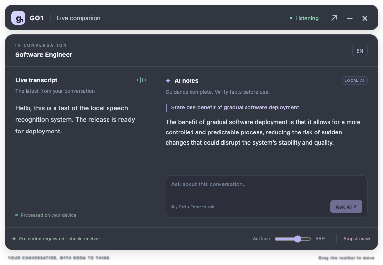
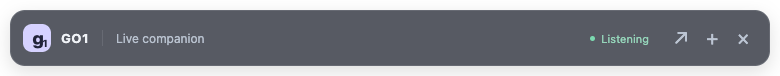
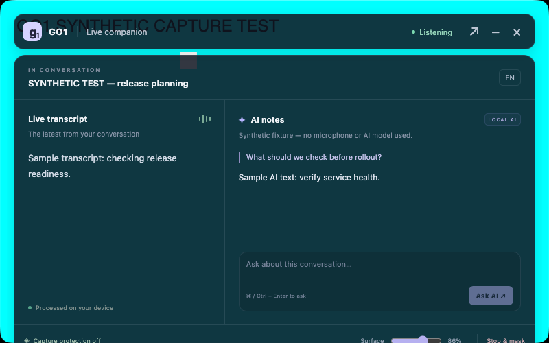
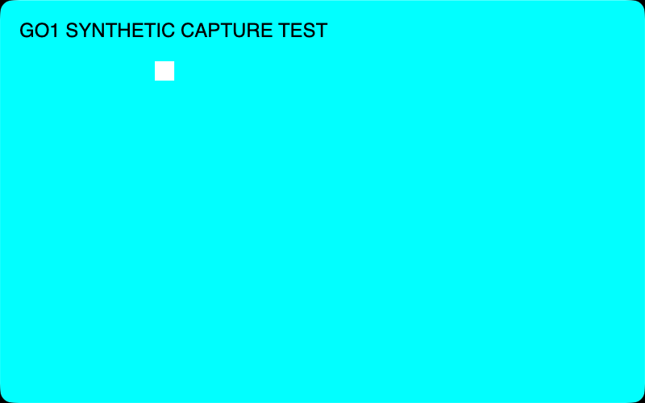

# GO Client comparison and GO1 v0.20 live presentation

The supplied GO Client DMG does not establish universal invisibility. Its observed Mac implementation uses standard Electron/AppKit controls. GO1 now includes the missing live-session Dock presentation behavior and uses the same Electron version for controlled comparison. Capture protection remains best effort and independent of speech/AI processing.

## Input and deeper inspection

- GO Client 2.0.11, build 2.0.11.1448, bundle com.imf.greatofferai.
- DMG SHA-256: 059ff75f28b7604966a800493c3c05c52aeebdf28ee1ccafed28a39e5c7a3b54.
- Its Info.plist has LSUIElement=true; its bundled Electron Framework reports 43.3.0.
- [Machine-readable static audit](evidence/go-client-native-audit-v020.json) includes original module hashes, Mach-O imported symbols/libraries, call-site line locations and Electron executable-section fingerprints.
- [Reproducible read-only inspector](../scripts/research/inspect-go-client.py) works on an already extracted copy. It does not execute the original client or redistribute its source/native binaries.

| Observed mechanism | DMG evidence | GO1 behavior |
|---|---|---|
| Capture request | main JS lines 18718, 18812: Electron content protection | Applied before content loads; all workspace, companion and review windows covered |
| Floating panel | lines 18613–18629: transparent, frameless, shadowless panel, background throttling off | Same core presentation configuration; transcription and enabled AI continue |
| Fullscreen/Spaces | lines 18712–18716: screen-saver level, all workspaces, skipTransformProcessType | Same configuration; restored on show/restore |
| Dock appearance | lines 27503–27516: accessory policy and Dock hide/show | New saved Mac option hides the icon while the companion is open; workspace arrow, closing the panel, stopping or Stop & mask restores it |
| Native taskbar utility | loader at 17766 returns immediately unless platform is win32 | Not treated as a missing Mac capture feature |
| Mac window-control imports | CGWindowListCopyWindowInfo, CGRectMakeWithDictionaryRepresentation and window metadata constants | These are enumeration/geometry evidence, not an imported capture-exclusion function |
| Electron runtime | framework Info.plist: 43.3.0 | Pinned to 43.3.0 for this comparison; native and real-inference tests rerun |

The Darwin window-control binary contains explicit Windows-only error messages for taskbar control and native pointer dragging. Its import table has no Objective-C message dispatch, NSWindow sharing setter, or CGS/SLS capture-blocking import. This narrows the observed role of that module; it does not prove that dynamically resolved behavior or all framework behavior is absent. The audio-capture module has CoreAudio/ScreenCaptureKit/audio pipeline dependencies; framework class-name strings alone do not establish a hidden window-exclusion mechanism.

The [Electron 43.3.0 Mac implementation](https://github.com/electron/electron/blob/v43.3.0/shell/browser/native_window_mac.mm) sets the native window's sharing type to NSWindowSharingNone and reads that value back. It is not a stronger Mac capture API than the previous GO1 version used. The workflow additionally compares official Electron's executable, C-string and Objective-C method-name sections with hashes computed from the supplied DMG, to check whether the observed runtime contains different code. A version string alone would not prove binary equivalence.

## What changed in GO1

- Live Dock mode is enabled by default on Mac and can be disabled under the presentation controls. Its setting is saved independently of capture protection.
- GO1 remains a normal Dock app at startup. It switches to accessory presentation when the live companion opens. Unlike GO Client's global LSUIElement preference, GO1 deliberately preserves normal first-run navigation.
- The companion's workspace arrow restores the Dock before focusing the workspace. Closing the companion, stopping a session and Stop & mask restore it too. Reopening the application restores/focuses its existing workspace.
- Rapid show/hide changes are serialized so an old asynchronous Dock-show completion cannot leave the final state wrong.
- Capture protection is reapplied after activation-policy changes. Dock errors are reported separately and do not cancel transcription or AI.
- The four bundled speech tools and optional local AI path remain intact. No proprietary native module, private window-server patch, process hiding or recording-permission bypass is added.

Dock hiding changes local app presentation. It does **not** prevent a meeting application from capturing a window. GO1 does not claim to disappear from process monitors or other system inspection tools.

## Why complete invisibility cannot be promised

[Electron documents](https://www.electronjs.org/docs/latest/api/browser-window#winsetcontentprotectionenable-macos-windows) that ScreenCaptureKit-based applications can capture a window despite content protection. [Apple documents NSWindowSharingNone](https://developer.apple.com/documentation/appkit/nswindow/sharingtype-swift.enum/none?language=objc) as legacy and advises against relying on it to omit captured content. [An Apple Developer Forums report](https://developer.apple.com/forums/thread/808016) describes capture differences after filter changes; Apple's response requests a reproducible bug report. That is a reason to test multiple capture states, not evidence of guaranteed exclusion.

The current implementation can match the observed API configuration. Only testing the exact OS, meeting client and share mode on a second receiving device can establish the result for that setup. The supplied GO Client itself has not been run in such a meeting during this task. Mac results do not establish Windows behavior; the platforms use different native protection mechanisms.

## Validation and download

**Passed on 22 November 2026.** Built source: [b010dc9](https://github.com/amey1234444/GO1/commit/b010dc9146f93785860f8952fd794c2ba4fe3f4d). [Successful Mac workflow](https://github.com/amey1234444/GO1/actions/runs/45053065905).

**[Download v0.20.0 for Apple Silicon](https://github.com/amey1234444/GO1/actions/runs/45053065905/artifacts/14765379908).** Sign in to GitHub, download the artifact ZIP, extract it and open **GO1-0.20.0-arm64.dmg** inside. Copy GO1.app to Applications. The installer is unsigned/not notarized; the artifact expires on 6 December 2026. See [installation and first-session setup](INSTALL_MAC.md).

| Validation | Observed result |
|---|---|
| Source checks and regression suite | 111 tests passed |
| DMG build, mount and bundled tools | Passed; all four embedded ARM64 speech tools verified |
| Actual packaged app | All 13 validation stages passed on macOS 15.8.2 |
| Live Dock mode | Native Dock hide/show, workspace recovery and restoration after stop passed without stopping the live session |
| Transcription with protection enabled | Actual bundled Whisper Base recognized the generated speech fixture |
| AI with protection enabled and Dock hidden | Actual local Ollama/Qwen2.5 0.5B output reached the companion in 34 streamed chunks |
| Independent native capture | Protected marker absent in tested screenshot/initial stream/refreshed stream paths on macOS 15.8.2 and 26.7.2; unprotected controls visible |
| Hardware microphone/system playback and remote meeting participants | Not tested by these jobs |

The [framework comparison](evidence/live-presentation-v020/framework-comparison.json) found exact matches for all three selected sections: executable code (`__text`), C strings (`__cstring`) and Objective-C method names (`__objc_methname`). The complete framework file hashes differ. This establishes identity of those selected sections, not every byte or every runtime behavior. It provides no evidence of a modified capture-protection implementation in those code sections.

The [packaged report](evidence/live-presentation-v020/packaged-smoke.json) records real Whisper recognition of: “Hello, this is a test of the local speech recognition system. The release is ready for deployment.” The single generated utterance took 7,926 ms of inference; the complete AI check took 16,902 ms. These are CI observations, not MacBook speed/accuracy guarantees. The CI model is smaller than the app's default Qwen3 4B. Audio enters at the existing PCM IPC boundary, so this test does not cover microphone permissions, physical devices or system-audio capture.

The [provenance manifest](evidence/live-presentation-v020/manifest.json) records source commits, workflow/artifact IDs, ZIP digests and preserved-file hashes. Both capture ZIPs, the packaged-evidence ZIP and the installer ZIP were downloaded and their digests checked. The extracted DMG hash matches the packaged execution report. This is a reproducible execution record, not independent certification or Apple notarization.

DMG SHA-256:

    5822b8ce14081fea0c3eb2ef419c0ea2c5cdf94cf4eca4abde4acabb4f7d5a0c

The build gate exercises real Whisper recognition and local AI streaming through the packaged app. It now also checks Dock hide/show, workspace recovery, continued live processing and restoration after stop. Separate capture experiments run on macOS 15 and 26 with unprotected controls, screenshots, initial streams and refreshed filters. No screenshot is labelled as a Google Meet receiver view without an actual Google Meet receiving-device test.

## Installation and build failure diagnosis

[Mac installation guide](INSTALL_MAC.md) explains extracting the GitHub artifact ZIP, opening the DMG, copying GO1 to Applications, first-launch approval, speech-model setup and optional AI setup.

The first v0.20 build attempted to inspect the framework immediately after npm installation. Electron 43's [runtime resolver](https://github.com/electron/electron/blob/v43.3.0/npm/index.js) downloads its executable on first use, so `node_modules/electron/dist` did not yet exist. Searching a different framework path alone did not solve this. The workflow now explicitly resolves `require('electron')` before inspection and discovers the framework binary under the installed distribution. The failed runs remain available; no required app validation was bypassed.

## Actual capture evidence

**Sender-side packaged app: real transcription of generated speech and real local AI output.** This image is captured from the app renderer, not a remote meeting participant or hardware microphone recording.

**Compact sender toolbar in the same live session:**

[Capture run 45048567161](https://github.com/amey1234444/GO1/actions/runs/45048567161) used source f6d44b6a6d0a16921ddf295c2f397a6f097f1293 and Electron 43.3.0. Both macOS 15.8.2 and 26.7.2 reported **excluded-in-tested-paths**. The ordinary protected window, GO1 panel, accessory-policy panel and selected-other-window case all omitted the marker in screenshots and sampled initial/refreshed stream frames. Both unprotected synthetic controls were visible in all three phases. Later commits correct only framework inspection/build setup; capture code and app code are unchanged.

Raw reports: [macOS 15](evidence/live-presentation-v020/capture-macos-15.json), [macOS 26](evidence/live-presentation-v020/capture-macos-26.json).

These images are from the independent ScreenCaptureKit observer on macOS 26, using the actual companion renderer with labelled fixture text. They show refreshed stream frames. The observer itself supplies no excluded application/window list. They are **not remote Google Meet screenshots** and do not establish microphone or AI inference performance. The report also preserves initial frames: the unprotected companion's first screenshot omitted it before later frames exposed it, illustrating why one screenshot alone is insufficient.

**Unprotected control: companion visible in the captured display region.**

**Protection enabled: companion absent in this capture path; underlying presentation remains.**

