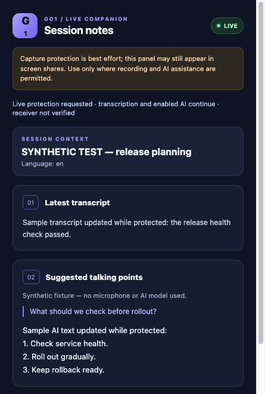
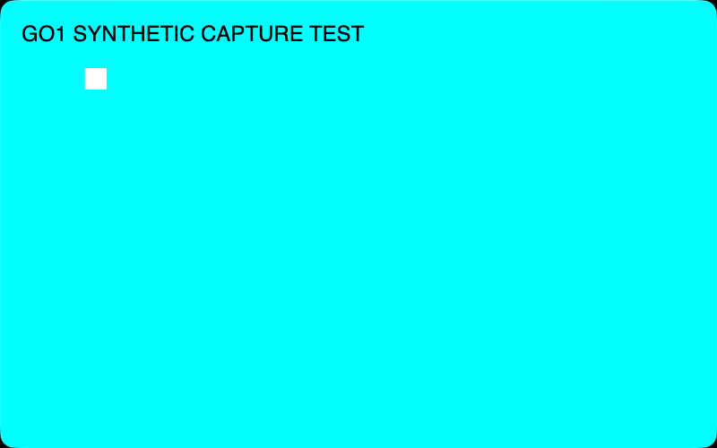
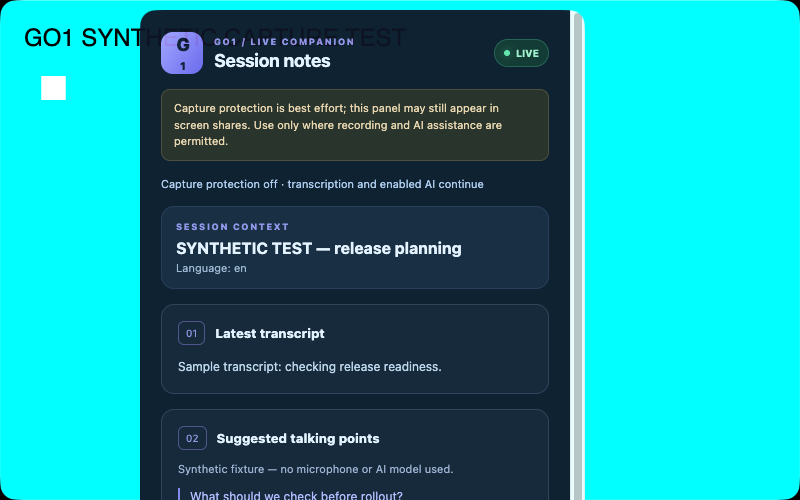

# Live capture protection, transcription and AI

GO1 v0.17 separates keeping a live session running from stopping private processing. Capture protection is an OS request; it is not a universal promise of invisibility.

| Control | Transcription | Enabled live AI | Window capture |
| --- | --- | --- | --- |
| Live capture protection (stealth), on | Continues | Continues, including an in-flight streamed response | Requests exclusion for workspace, companion and review |
| Live capture protection, off | Continues | Continues | Windows can be captured |
| Stop & mask / emergency shortcut | Stops | Cancels | Clears private content and closes companion/review |

If Stop & mask is active, return to the workspace and start a new session. Enabling capture protection alone never resumes a stopped microphone or bypasses permission. AI still requires the session's AI option and an installed/running local Ollama model. Transcription requires the selected speech model and local worker.

## Implementation and checks

The protection toggle only changes the window capture request and persisted setting. It does not enter `PrivacyGate`, cancel a worker, abort AI, or clear the transcript. Changes are broadcast to the workspace and companion immediately. Activity status distinguishes an active session, AI availability, an in-flight AI request and an emergency pause.

Both live windows set `backgroundThrottling: false` so Electron does not deliberately throttle their timers/animations when backgrounded. [Electron API documentation](https://www.electronjs.org/docs/latest/api/web-contents#contentssetbackgroundthrottlingallowed). This does not override computer sleep, revoked audio permissions or external service failures.

Integration tests execute the actual main module, PCM normalization, VAD segmentation, transcript aggregation and streaming AI parser. For both microphone and system-audio source labels, they keep speech inference and AI pending, toggle protection on/off/on, and check that neither signal is aborted. They then verify transcript and AI updates reach both the workspace and companion. Native audio capture and model responses are controlled test boundaries; this is not a claim that real Whisper/Ollama inference was exercised by these tests.

The Mac capture experiment also loads the **real companion HTML, CSS and restricted preload**, supplies labelled synthetic transcript/AI text, enables protection, hides the panel, updates both texts, verifies the DOM, and shows the panel again. It saves:

- `sender-panel.png`: real app-rendered content through `webContents.capturePage`, not a desktop screenshot.
- `sender-guidance.png`: the same real panel scrolled to its guidance.
- `unprotected-display/screenshot.png`: independent ScreenCaptureKit capture before protection.
- `protected-display/screenshot.png` and stream PNGs: independent capture after protection, with no app/window exclusion in the observer's display filter.

The images contain synthetic test data. They are **not Google Meet screenshots**, and no image has a fabricated Meet interface. The companion probe checks rendering continuity; the separate marker probe checks measurable capture exclusion. Neither is a meeting receiver certification.

## Recorded app and capture screenshots — 22 November 2026

[Download GO1 v0.17.0 Apple Silicon DMG](https://github.com/amey1234444/GO1/actions/runs/44982275234/artifacts/14738054082). This is an unsigned build; the artifact expires 6 December 2026. The successful second build attempt passed the 96 tests, native protection API checks and mounted-DMG verification. The first attempt failed during the DMG maker's mount-detach cleanup; it is retained in the workflow history.

Tested commit: [`ad334687783f987a5e3e237e464640bf1341e57c`](https://github.com/amey1234444/GO1/commit/ad334687783f987a5e3e237e464640bf1341e57c). [Capture workflow](https://github.com/amey1234444/GO1/actions/runs/44982275304). The 96 automated tests passed. On both macOS 15.8.2 and 26.7.2, Electron 39.8.10 rendered the updated transcript and AI fixture text after protection was enabled and the panel was hidden/reopened. Native background throttling read back as false.

The pictures below are **unmodified images from the macOS 26 workflow artifact**. The left image shows the real companion's rendering. The right image is a frame from the independent ScreenCaptureKit stream after its filter was refreshed, covering the cyan presentation rectangle. They are different capture surfaces, not two screenshots from a Google Meet call.

| Local companion content, protection enabled | Independent presentation capture, protection enabled |
| --- | --- |
|  |  |

For comparison, the same observer's refreshed stream **with protection disabled** included the real GO1 companion:

The protected companion trial sampled 21 initial and 21 refreshed stream frames per OS. Native metadata reported the window onscreen. The protected capture retained more than 395,000 cyan background pixels out of 400,000, while the unprotected streams fell to about 179,000 because the visible panel covered the background. These counts support the visual comparison; they do not identify every possible private pixel or certify a remote meeting.

**A useful counterexample:** the first unprotected still screenshot omitted the panel, but subsequent unprotected stream frames showed it. We preserve both. A single screenshot would have produced a misleading conclusion; live/refreshed stream controls matter.

Evidence files:

- [macOS 26 complete report](evidence/live-protection/macos-26/report.json), [scrolled local guidance view](evidence/live-protection/macos-26/companion-live/sender-guidance.png).
- [macOS 15 complete report](evidence/live-protection/macos-15/report.json), [local companion view](evidence/live-protection/macos-15/companion-live/sender-panel.png), [protected stream frame](evidence/live-protection/macos-15/companion-live/protected-display/streamRefreshed.png).
- [Provenance and file hashes](evidence/live-protection/manifest.json). Original downloaded artifact ZIP hashes were checked against GitHub's digests. This is an unsigned evidence record, not an independent certification.

## Google Meet: actual two-device acceptance test

**Current status: not run.** There is no connected MacBook/Google Meet sender plus second receiving device in this execution environment. The existing [Mac pixel evidence](MACOS_CAPTURE_VALIDATION.md) cannot be relabelled as a meeting result.

Google documents three separate presentation sources: a browser tab, a window, or the entire screen. Follow [Google's presentation instructions](https://support.google.com/meet/answer/9308856?hl=en) and record which source was selected; a successful tab-sharing check does not establish full-screen exclusion.

1. On the sender Mac, record the GO1 commit/version, macOS version, browser version, speech model and Ollama model. Check microphone/system-audio permissions and local AI readiness.
2. Join a private test Meet from that Mac and from a second device. Mute the receiver microphone/speakers to avoid feedback; use benign sample content.
3. Enable **Live capture protection (stealth)**, start a permitted session with AI enabled, and open the companion. Keep the panel over the material you plan to share. Do not activate **Stop & mask**.
4. Speak a unique phrase and request guidance. Verify fresh transcript and AI text locally; an old transcript or cached response is not evidence of continuing processing.
5. Present an unrelated specific tab/window. Save a receiver-device screenshot showing the shared material. Then separately test **entire-screen** sharing. Each source needs its own result.
6. With sharing still active, speak a second unique phrase and request another AI response. Save the sender view with an external camera if protected content is omitted by local screenshot software; save the receiver screenshot on the receiving device. Label capture methods accurately.
7. Repeat after stopping/restarting the share, foregrounding another app, moving the companion, changing Spaces/fullscreen, and moving to a second display. Test all GO1 windows you may open, including workspace and review.
8. If GO1 appears anywhere in the receiver's shared video, record a failure for that exact configuration. Use selected-other-window/tab sharing or Stop & mask as appropriate. Do not mark the run passed merely because the sender preview is blank or the API flag is true.

### Evidence to attach for a real Meet run

Create a folder under `docs/evidence/meet/` with the sender image, receiver image, a short receiver recording covering transitions, and a JSON/text record of versions, share source, timestamps, fresh-phrase/AI checks and pass/fail observations. Remove meeting codes, account addresses and private conversation text before publishing. A redacted image must be labelled as redacted and retain an unmodified private original if provenance is needed.

| Required result | Status |
| --- | --- |
| Fresh transcript while protection is enabled | Automated integration fixture passes; real meeting not run |
| Fresh AI stream while protection is enabled | Automated integration fixture passes; real meeting not run |
| Google Meet other-window/tab receiver excludes GO1 | Not run |
| Google Meet full-display receiver excludes GO1 | Not run |
| Fullscreen, share restart and second-display receiver checks | Not run |
| Windows receiver behavior | Not run; Mac results do not establish it |
