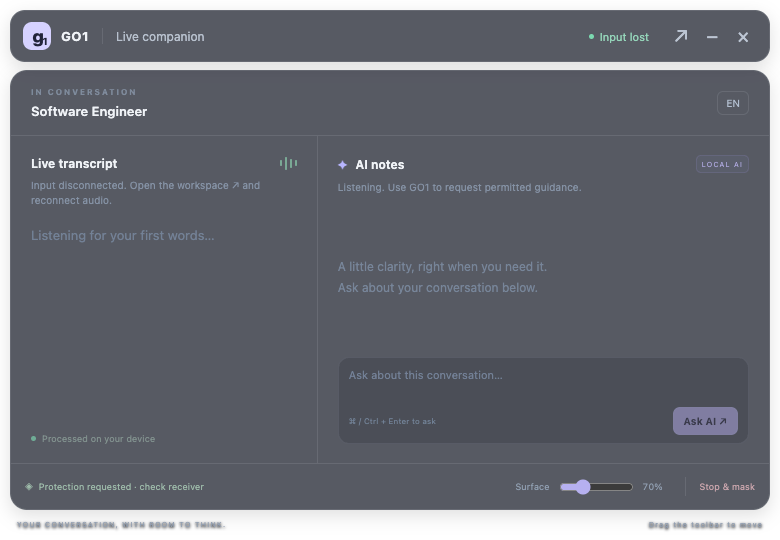
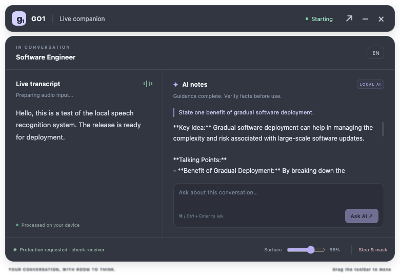

# v0.24: stable live sessions and audio recovery

## Changes

- The workspace minimizes **after** the renderer has connected and resumed its AudioWorklet and the companion is available. Permission/model startup failures remain visible in the workspace. The companion's workspace arrow restores a minimized workspace; closing only the panel restores workspace navigation without cancelling the session.
- Silence produces no speech-engine requests and does not produce a session-stop event. The companion distinguishes starting, waiting for audio, hearing audio, muted input, disconnected input and system-paused audio.
- Recoverable recognition failures no longer poison the VAD queue or tell the renderer to stop recording. Already recognized text stays available; subsequent utterances can be recognized.
- A lost local Whisper connection restarts GO1's own worker and retries that utterance once. Cancellation and Stop & mask still stop processing; recovery never silently enables recording after a stop.
- Recognition queue memory stays bounded at three pending utterances. If the model falls behind, the app reports skipped audio and retains timestamped gap information in the result instead of closing the session or silently claiming a complete transcript. Choose Base/Tiny or Balanced responsiveness if this occurs.
- Microphone and system-audio tracks share mute/unmute/disconnect handling. **Reconnect audio** in the workspace uses the same permission-based acquisition path as initial capture and keeps the session/transcript when successful. A failed reconnect leaves the existing session open; it does not bypass OS permissions or automatically choose a different source.
- **Quiet voices** sensitivity lowers the acoustic gate to admit softer speech, with an explicit background-noise tradeoff. Balanced remains the default. This is not a new neural VAD or a promise of perfect recognition.
- Studio launch preserves the selected Balanced/Fast responsiveness instead of forcing Fast.
- Optional live AI uses a 45-second inactivity limit and a three-minute total limit. Progressing tokens can continue beyond 45 seconds; stop still cancels the stream. The first native run revealed a real timeout while a local model was still producing text; the corrected build completed its real AI response in 61.4 seconds.
- The lossless DMG compression comparison and runtime-only package allowlist remain enabled. No speech language or required native executable is removed.

## Concrete failure corrected

Before this change, `VadLiveSession` stored any inference exception as a permanent failure and emitted `type: error`. The renderer reacted to every such event by calling `stopRecording()`, which closed the companion. A transient `fetch failed` could therefore appear to the user as a session that vanished when audio became quiet. A stalled model queue also permanently failed the session. The user's actual hardware failure has not been reproduced; these are confirmed code paths corrected by tests.

In v0.24, recoverable failures produce a warning and a recorded gap. Fatal invalid-PCM/protocol errors, explicit Stop & mask and explicit stop still end processing. The existing 30-minute recording limit is unchanged; this release does not claim indefinite sessions.

## Reference behavior in the supplied GO Client DMG

The supplied 2.0.11 bundle's `out/main/index.js` contains:

| Reviewed location | Observation | GO1 implementation |
|---|---|---|
| `handleAgentError`, approximately lines 17387–17425 | Recoverable transcription/audio-push errors are logged without tearing down the interview runtime; session expiry/fatal errors are separate | Independent recoverable-warning path, bounded retry and gap reporting |
| `AudioDiagnosticsMonitor`, approximately lines 14956–15035 | Capture-start/active/stop and interval metrics have separate lifecycle events | Input status, existing RMS/clipping/frame diagnostics, explicit reconnect |
| Dashboard window transition, approximately line 27721 | Original dashboard can be hidden while the assistant is shown | User-requested minimize-after-audio-ready behavior with workspace restoration |

The original uses native audio and authenticated cloud services. GO1 continues to use MediaStream/AudioWorklet, local Whisper and optional Ollama. It does not reproduce the original dual-channel native capture, remote dialogue pipeline or production accuracy/latency. [Full comparison](GO_CLIENT_FULL_PACKAGE_STUDY.md).

## Usage

1. Install/select a multilingual speech model in GO1. Base is the smaller initial choice. Installing Homebrew executables alone does not install/select GO1's model weights.
2. Choose **Microphone** for your voice or **Mac system playback** for computer audio; grant the matching permission. These are separate choices, not simultaneous dual-source capture.
3. Launch the live session. The workspace minimizes once capture is ready; the companion remains available.
4. Quiet periods show **Waiting for audio**. A device disconnect shows **Input lost**. Use **↗ → Reconnect audio** to reconnect explicitly.
5. Try **Quiet voices** if the meter shows soft input but speech is being missed. Background noise may also pass this more sensitive gate. Choose the spoken language explicitly when known.
6. For slow recognition, use Base/Tiny or Balanced responsiveness and inspect Latency Lab. Large local models and optional Ollama compete for memory/compute.

## Validation and download

**[Download GO1-0.24.0-arm64.dmg — 104.0 MiB](https://github.com/amey1234444/GO1/releases/download/v0.24.0-mac.36/GO1-0.24.0-arm64.dmg)** · [Checksum](https://github.com/amey1234444/GO1/releases/download/v0.24.0-mac.36/GO1-0.24.0-arm64.dmg.sha256) · [Installation](INSTALL_MAC.md).

Source commit: `06a9c789d0eb9f29c4022b24b8bf940f6f918e66`. The DMG is **109,091,041 bytes**; SHA-256 `4409208e7090e82be3453d4740023513261c97464cf06825cc2a9c5781ce6521`. Lossless ULMO compression saves 27,310,289 bytes (20.0%) against this build's UDBZ image. The installed app is 360,286,615 bytes; speech models and Ollama are separate. This is a measured reduction, not a claim of the theoretical smallest possible app.

| Check | Result and scope |
|---|---|
| [Source checks and regression suite](https://github.com/amey1234444/GO1/actions/runs/45148155762) | **127 passed**; includes a minute of silence followed by speech, failed-utterance recovery, overload, soft-voice gating, bounded worker retry, both source labels' lifecycle and AI progress/stall/cancellation |
| [Actual DMG app on macOS 15.8.2 ARM64](https://github.com/amey1234444/GO1/actions/runs/45148155847) | **18/18 stages passed**; mounted/copy signature verification, real bundled speech inference and actual Ollama response |
| Renderer capture lifecycle | Actual AudioWorklet, synthetic silent MediaStream, workspace minimized, 11 audio-health frames over 5.5 seconds at RMS zero; session remained active |
| Lost input and reconnect | Ended track showed **Input lost**; panel/session stayed open; explicit reconnect to a replacement synthetic stream preserved session ID |
| Worker crash | Terminated GO1's owned native Whisper process; next generated speech was transcribed without closing the session |
| Imported audio | Real bundled FFprobe, FFmpeg and Whisper CLI completed |
| [Native capture jobs, macOS 15 and 26](https://github.com/amey1234444/GO1/actions/runs/45146042793) | Both completed successfully at commit `01d54d846e6dd79aa377e526ded02102eb9120ae`; the subsequent commit changed AI timeouts and Studio responsiveness only. Local pixel experiments are not meeting certification |
| Physical microphone / system playback / OS permissions | **Not tested on user hardware**; synthetic acquisition does not certify these |
| Zoom, Google Meet and Teams receiving devices | **Not verified**; whole-screen invisibility is not guaranteed |
| Apple download policy | Signature integrity passed; **Gatekeeper rejected** the ad-hoc preview; notarization remains missing |

The existing 30-minute recording cap remains. Transcription accuracy depends on language, input quality and selected model; quiet sensitivity can admit additional background noise. Microphone and system playback are separate choices, not simultaneous dual-source recording.

### Actual packaged-app screenshots

These are unmodified screenshots from the successful Mac workflow, not design mockups or remote participant views. [Provenance and file hashes](evidence/live-reliability-v024/provenance.json).

**Input disconnect:** the companion remains visible, explains the missing input and points to the workspace reconnect action. The later test verifies reconnection into the same session.

**Real local speech and AI:** generated speech passed through bundled Whisper; an actual Ollama request streamed into the protected companion. This older test stage injects PCM directly at the IPC boundary, so its input badge remains “Starting”; the separate renderer capture test above checks real AudioWorklet startup and input-state transitions.

**Compact presentation:** the packaged test switches the existing companion into compact mode and verifies retained text when reopened.

### Evidence and limits

- [Complete 18-stage report](evidence/live-reliability-v024/packaged-smoke.json)
- [Package integrity, size and SHA-256](evidence/live-reliability-v024/package-integrity.json)
- [Compression comparison](evidence/live-reliability-v024/compression.json)
- [Quarantined-copy policy result](evidence/live-reliability-v024/download-policy.json)
- [Earlier failed native run exposing the AI timeout](https://github.com/amey1234444/GO1/actions/runs/45146042963)

The policy assessment still reports a missing notarization ticket and an internal XProtect error. The [independent minimal-app control experiment](MAC_INSTALLER_V023.md) reproduced the latter on both runners; that does not make this build Apple-approved or guarantee a normal browser-download/Finder first launch. Developer ID signing and notarization require the repository owner's Apple credentials.

Live capture protection continues to request OS exclusion while transcription and enabled AI run. **Stop & mask** deliberately stops both. macOS capture APIs and meeting share modes can still expose protected windows; verify the receiver using the [meeting test checklist](INSTALL_MAC.md#verify-your-meeting-setup).
