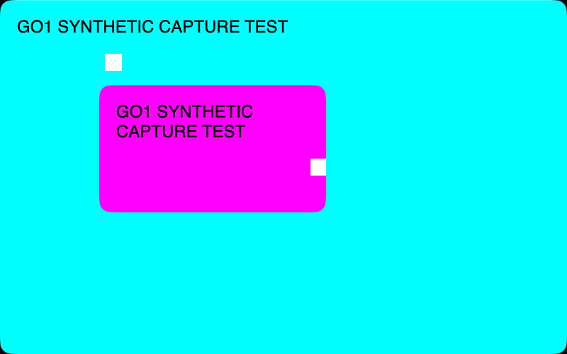
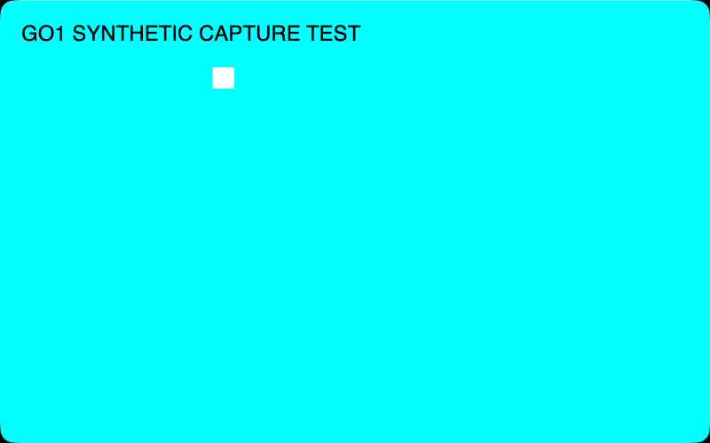

# macOS capture validation: v0.16

## Focus

This change focuses on the Mac presentation behavior requested by the user. Windows/MSI investigation is not part of this follow-up. A Mac capture result cannot establish Windows behavior.

The earlier real Electron smoke test proved that `isContentProtected()` returned true. It did **not** prove that protected pixels were absent from a capture. This experiment tests pixels through an independent ScreenCaptureKit observer.

## Recorded results: 22 November 2026

Tested source: [`cda3e00eb1dac348a211051181da18eaf257d722`](https://github.com/amey1234444/GO1/commit/cda3e00eb1dac348a211051181da18eaf257d722). Both hosted Mac runners compiled the independent Swift observer and completed all six scenarios. Electron was **39.8.10**. The display filter had **no excluded windows or applications**.

| Runner OS | Protected GO1 panel screenshot marker pixels | Initial / refreshed stream frames | Maximum marker pixels in either stream | Verdict |
| --- | ---: | ---: | ---: | --- |
| macOS 15.8.2, build 24H232 | 0 | 21 / 22 | 0 | Excluded in tested paths |
| macOS 26.7.2, build 25G332 | 0 | 20 / 21 | 0 | Excluded in tested paths |

In both runs, native metadata reported the marker onscreen, at window layer 1000. The cyan background remained visible, so these were not blank captures. Unprotected ordinary windows and unprotected panels were visible in every phase, with more than 53,000 marker pixels. Protected ordinary windows, protected panels, the accessory-policy variant and selected-other-window capture all excluded the marker in the tested paths.

This supports the content-protection request as the observed difference in this experiment. The screen-saver window level alone did **not** prevent capture. Hiding the Dock was not necessary for the successful results here.

Preserved original reports, including every sampled frame count:

- [macOS 15 report](evidence/macos-capture/macos-15/report.json)
- [macOS 26 report](evidence/macos-capture/macos-26/report.json)
- [Evidence provenance and SHA-256 manifest](evidence/macos-capture/manifest.json)
- [Capture experiment run and complete artifact ZIPs](https://github.com/amey1234444/GO1/actions/runs/44979825998)

Representative **actual captured images**, macOS 26 (synthetic fixture):

Unprotected control — magenta window appears:



Protected GO1 panel policy — cyan presentation remains, magenta window is absent:



The protected initial/refreshed stream PNGs are preserved beside each report. These are unmodified files extracted from the workflow artifacts; both downloaded ZIP SHA-256 hashes matched GitHub's reported digests. The manifest is an evidence record, **not** an independent certification or signed GitHub artifact attestation.

**Scope:** the fixture imports GO1's production panel configuration and content-protection controller. It does not exercise a real live session or the packaged application's complete UI. No Zoom, Google Meet or Teams receiver was connected; no fullscreen/Spaces transition or secondary display was tested. These results do not establish complete invisibility, non-detectability, the original GO Client's runtime behavior, or Windows capture behavior.

### Mac build and checks

[Mac build run](https://github.com/amey1234444/GO1/actions/runs/44979826090): **94 tests passed, zero failed**; source checks and native Electron protection-flag tests passed. The generated DMG passed `hdiutil verify`, mounted read-only, and contained the app plus four ARM64 transcription tools. Those checks validate packaging and API state, not receiver-side exclusion.

[Download GO1 0.16.0 Apple Silicon DMG artifact](https://github.com/amey1234444/GO1/actions/runs/44979826090/artifacts/14737715553). It is **unsigned** and the GitHub artifact expires on 6 December 2026. The artifact ZIP digest is recorded in the manifest; it is not the hash of the DMG contained inside it.

## What was found in GO Client 2.0.11

The attached DMG's verified hash and original bundle offsets remain in [the static evidence index](evidence/go-client-2.0.11-static.json). In `out/main/index.js`:

- Lines 18601–18637 create a frameless, transparent, shadowless, always-on-top assistant; on macOS its type is `panel`.
- Lines 18712–18718 set the screen-saver window level, visibility across workspaces/fullscreen and content protection.
- Lines 17949–17965 distinguish explicit focused display from `showInactive()`.
- Lines 27503–27515 implement accessory/regular app policy and Dock visibility separately.
- Lines 19083–19096 implement mouse passthrough separately.

These are distinct behaviors. Window level, transparency, inactive display, Dock visibility and mouse handling do not individually prove capture exclusion. The inspected native exports do not establish a stronger macOS capture-exclusion mechanism. The original proprietary app has not been executed in a real Zoom/Teams/Meet call during this task.

## GO1 changes

`src/privacy/companion-window.js` is shared by the real companion and the synthetic probe. On macOS it uses `type: panel`, no frame/shadow, transparent window backing, skip-taskbar and always-on-top options. It reapplies screen-saver level and all-workspaces/fullscreen behavior on show/restore. The panel's initial display uses `showInactive()`. Its header is draggable and controls remain interactive.

`ContentProtection` still owns the independent `setContentProtection` request. Standard workspace and review windows remain protected too. The existing stop-and-mask gate remains available. The probe's accessory-policy variant tests another original-app setting without changing GO1's normal Dock/recovery behavior.

## Actual capture experiment

The Electron driver renders a cyan synthetic presentation window and a magenta synthetic private panel. Both contain test labels; no transcript, microphone or account is used. The independent Swift process captures only the 800 × 500-point fixture rectangle (or the selected fixture window). It does **not** exclude GO1/the marker app from the display filter.

It runs these scenarios:

| Scenario | Purpose |
| --- | --- |
| Unprotected ordinary window | Positive control: confirm the capture can see magenta pixels |
| Protected ordinary window | Isolate the content-protection request |
| Unprotected panel | Observe panel configuration without the request |
| Protected GO1 Mac panel | Test the production companion's shared window configuration |
| Protected panel with accessory app policy | Compare the additional Dock/app-policy setting found in the original |
| Selected synthetic presentation window | Test source selection while the panel is also onscreen |

For each scenario it records:

1. `SCScreenshotManager` screenshot.
2. Complete frames from a live `SCStream`.
3. Frames after re-enumerating shareable content and updating the stream's filter.
4. Native onscreen/window-layer metadata, Electron state, pixel counts and representative PNGs.

This tests a modern macOS capture API; it is **not an actual Zoom/Teams/Meet receiver test**. Meeting/browser versions, sharing source, capture filters, fullscreen/Spaces transitions and remote rendering can change results. Separate local UI/fullscreen checks and receiver-device testing are still required.

## How the result is interpreted

- `exposed`: the protected marker appears in any tested screenshot/stream phase.
- `excluded-in-tested-paths`: valid control/background pixels and an onscreen marker, with no marker pixels in all three tested phases. This is scoped to those paths and that machine/version.
- `inconclusive`: missing/ambiguous pixels, no valid positive control, offscreen marker or absent stream frames.
- `blocked`: Screen Recording permission was unavailable.
- `error`: capture/setup failed.

A green workflow means the experiment collected its report; it does not mean invisibility passed. Read `report.result` and the individual trial verdicts. The report always sets `receiverVerified: false`. The classifier is covered by regressions preventing blank frames, offscreen markers and denied permissions from becoming false success results.

## Run on your MacBook

From this repository, using macOS 14+ and Xcode command-line tools:

```sh
npm install
bash scripts/macos/build-capture-probe.sh
GO1_REQUEST_SCREEN_PERMISSION=1 npm run probe:capture
```

If prompted, grant the test process Screen Recording permission in System Settings, restart the invoking app/terminal as macOS requests, then rerun `npm run probe:capture`. The probe will not change TCC databases or bypass permission checks. Without permission, it writes `blocked`.

Results and PNGs are written to `out/capture-evidence/`. During the test, leave the synthetic windows uncovered and avoid interacting with them. Close private windows before running if you do not want even accidental content inside the test rectangle. The probe does not capture audio.

The CI experiment runs separately on `macos-15` and `macos-26`, with a maximum job time and uploaded evidence. A hosted runner may lack Screen Recording permission; that is recorded explicitly rather than treated as pass.

## Meeting receiver verification

Use a second device with consenting test participants. Show the synthetic marker panel or benign sample content, then share an unrelated specific window and the full display in each meeting app. Save receiver-side screenshots/video and record the Mac version, meeting/browser version, GO1 commit and share source. Repeat after restarting the share, moving displays, switching Spaces/fullscreen and recreating the companion. Check both the workspace and companion; do not extrapolate from only one protected window.

If a receiver sees the marker, full-display exclusion fails for that configuration. Use a specific other window/tab or stop-and-mask. A local API flag, sender preview or screenshots from a different app cannot establish the receiver's result.

## Primary references

- [Electron window types: macOS panel](https://www.electronjs.org/docs/latest/api/structures/base-window-options)
- [Electron content protection and ScreenCaptureKit limitation](https://www.electronjs.org/docs/latest/api/browser-window#winsetcontentprotectionenable-macos-windows)
- [Apple NSWindowSharingNone](https://developer.apple.com/documentation/appkit/nswindow/sharingtype-swift.enum/none)
- [Apple ScreenCaptureKit sample and capture filters](https://developer.apple.com/documentation/screencapturekit/capturing-screen-content-in-macos)
- [Apple developer forum: capture behavior changes after filter updates](https://developer.apple.com/forums/thread/808016)

Apple documents the sharing-none flag as legacy and unsuitable as a guarantee against capture. The probe measures behavior instead of assuming the original product's marketing claim is universally true.
