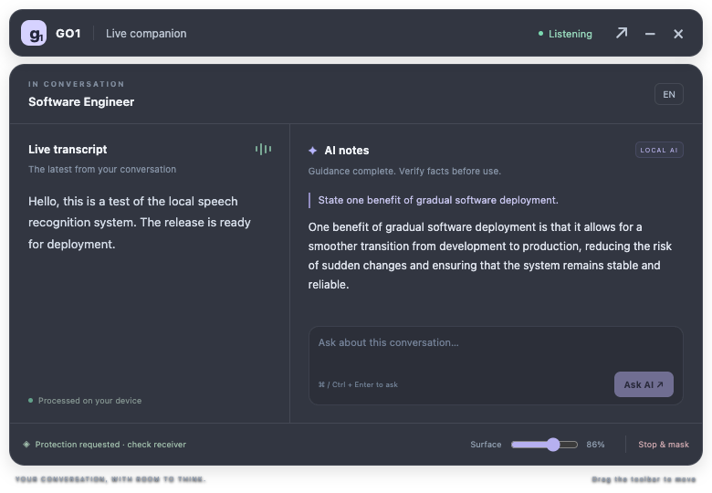

# v0.22 Mac installer integrity and direct downloads

## Why this change was needed

A user reported a “damaged” error while installing GO1. The exact macOS message and whether it occurred during copying or first launch have not yet been supplied, so the user's specific failure is not confirmed.

The previous workflow built an unsigned/unnotarized preview. It verified the DMG container, its bundled native tools and app behavior, but did not run `codesign --verify --deep --strict`, assess Gatekeeper trust or reproduce browser quarantine. Launching the executable directly on a CI runner does not establish that a downloaded app will pass Finder's first-launch checks. Apple's [damaged-app guidance](https://support.apple.com/guide/mac-help/mh40619/mac) explains that altered code and signature mismatches can trigger this warning.

## Corrections

- **Seal the final app:** Mac previews are explicitly ad-hoc signed after Electron is renamed and native tools are copied. The signer processes nested Mach-O binaries before sealing the outer bundle. Signing errors fail packaging instead of being treated as warnings.
- **Check the actual mounted image:** verify the app and native executable signatures, record the signer, run Gatekeeper assessment and record its exit code. Developer ID builds must also pass stapled-ticket validation and Gatekeeper assessment.
- **Check a copied app:** the packaged speech/AI test uses `ditto` to copy the app from the mounted DMG into a writable directory, verifies the copy's signature and launches that copy. This checks copying and runtime behavior, but does not reproduce browser quarantine or dragging in Finder.
- **Reduce payload:** package only `src`, `package.json` and the project license in the ASAR. Research evidence, tests, scripts and build directories stay out. Native tools occur once in Resources/native. No Electron runtime, supported speech language or required speech executable is removed.
- **Compress the DMG:** use UDBZ (bzip2) instead of the earlier default zlib image. Do not build an additional Mac app ZIP.
- **Direct download:** publish the tested `.dmg`, its SHA-256 file and machine-readable evidence as GitHub Release assets. GitHub Actions artifacts remain ZIP-wrapped internally, but users can download the release DMG directly.

Ad-hoc signing verifies integrity; it does **not** identify a trusted developer or supply Apple's notarization ticket. An ad-hoc preview may still be blocked by Gatekeeper after a browser download. It must not be described as a warning-free installer.

## Apple-signed distribution setup

In repository **Settings → Secrets and variables → Actions**, add these repository secrets using your own Apple Developer account. Do not put their values in chat, source code, issues or screenshots.

| Secret | Value |
|---|---|
| `APPLE_CERTIFICATE_P12_BASE64` | Base64 encoding of an exported Developer ID Application certificate **including its private key** in a password-protected `.p12` |
| `APPLE_CERTIFICATE_PASSWORD` | Password used to export that `.p12` |
| `APPLE_SIGNING_IDENTITY` | Exact identity, for example `Developer ID Application: Your Name (TEAMID)` |
| `APPLE_ID` | Apple account used for notarization |
| `APPLE_APP_SPECIFIC_PASSWORD` | App-specific notarization password, not your Apple account login password |
| `APPLE_TEAM_ID` | Apple Developer team ID |

The trusted main-branch workflow imports the certificate into a temporary runner keychain, signs with hardened runtime, notarizes the application through Electron Forge and validates the stapled ticket. It deletes the temporary certificate/keychain at completion. No signature credentials are embedded in the installer.

Run **Actions → macOS Apple Silicon DMG → Run workflow**, selecting **require_notarization** to require this path. Missing or partial credentials, signing failures, failed notarization or rejected Gatekeeper assessment stop the release. Without any credentials and without that requirement, CI can publish only an explicitly labelled ad-hoc prerelease. Pull requests do not publish releases.

The signed path is implemented but cannot be certified until it has run successfully with a real Developer ID certificate. See [Electron Forge signing](https://www.electronforge.io/guides/code-signing/code-signing-macos) and [Apple Developer ID distribution](https://developer.apple.com/developer-id/).

## Validation

[Download GO1-0.22.0-arm64.dmg directly](https://github.com/amey1234444/GO1/releases/download/v0.22.0-mac.32/GO1-0.22.0-arm64.dmg) · [Release and checksums](https://github.com/amey1234444/GO1/releases/tag/v0.22.0-mac.32)

**This published build is an ad-hoc preview, not Apple-notarized. Gatekeeper rejected it (exit code 3).** The workflow reported that no Apple credentials were configured. The signature integrity correction passed, but normal browser-downloaded first-launch trust remains blocked pending Developer ID signing/notarization. The user's exact original error has not been reproduced.

| Check | Recorded result |
|---|---|
| Source commit | `bdd8403799f61d825b8e124069e58aa06842631f` |
| Mac build / publication | [Run 45081962658](https://github.com/amey1234444/GO1/actions/runs/45081962658), both jobs passed |
| Source tests | 115 passed |
| Packaged app from copied bundle | All 15 stages passed; real Whisper speech recognition, real Ollama streaming, duplicate instance, restart, protection toggles and shutdown |
| Mounted and copied signatures | Passed deep/strict app verification; native tools verified |
| Gatekeeper | Rejected, exit 3; ad-hoc signature is not Developer ID trust |
| Browser quarantine / Finder first launch | Not tested |
| DMG format and size | UDBZ, **136,368,448 bytes = 130.1 MiB** |
| Previous v0.20 DMG | 178,326,053 bytes = 170.1 MiB; new image **23.5% smaller** |
| Installed app payload | 360,276,501 bytes; app ASAR 243,577 bytes; native tools/licenses 71,419,879 bytes |
| Separate native capture workflow | [Run 45081962756](https://github.com/amey1234444/GO1/actions/runs/45081962756): macOS 15 and 26 jobs passed; no remote meeting receiver certification |

DMG SHA-256: `85ddea6238c430750cfcf44d1fbcaf5a910c03226023377ed33dcaa57ca5fe43`. The published release asset's size and SHA-256 match the build evidence. Model weights and Ollama are not included in the DMG size.

Evidence: [package size/signing report](evidence/mac-installer-v022/package-integrity.json), [15-stage runtime report](evidence/mac-installer-v022/packaged-smoke.json), [signature identity](evidence/mac-installer-v022/signature.txt), [Gatekeeper output](evidence/mac-installer-v022/gatekeeper.txt), [provenance and evidence hashes](evidence/mac-installer-v022/provenance.json).

Release-gate fixtures accepted a valid preview, rejected a modified DMG and rejected a notarized claim with a failed Gatekeeper assessment. Signing-configuration fixtures rejected missing required credentials and partial credentials. The Apple-notarized branch remains untested without actual credentials.

### Actual copied-app screenshot

Local renderer after generated speech was transcribed by bundled Whisper and a real Ollama answer streamed. This is not a browser first-launch or meeting receiver screenshot.

