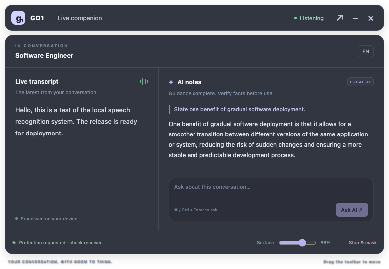
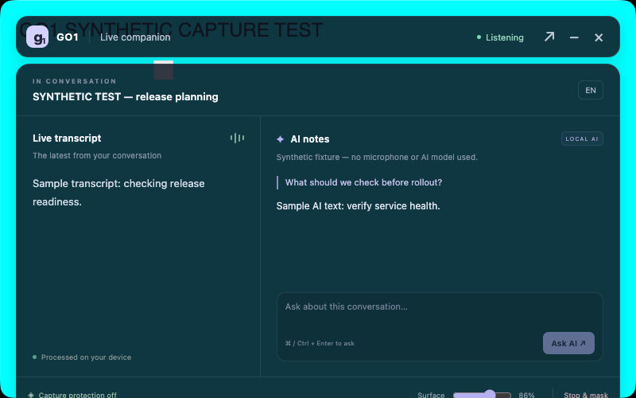
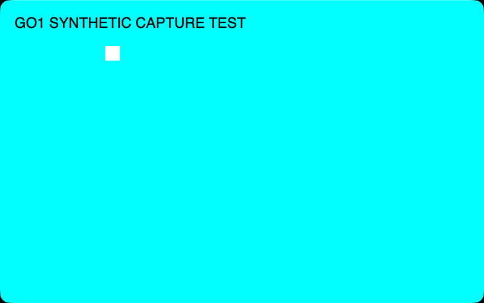

# v0.19 packaged Mac app validation

The requested comparison has two separate questions: whether the application functions, and whether a particular meeting capture path excludes it. Passing one does not prove the other. GO1 implements local speech recognition and optional local AI; it is not a complete replica of GO Client's cloud services, account system or all features.

## Changes

- Reserve live startup before waiting for the model, preventing overlapping starts and concurrent batch transcription/model changes.
- Invalidate pending startup on Stop & mask or workspace close. A failed startup releases the reservation and resets its worker so retry is possible.
- Bind transcript/status callbacks to the session that created them. Discard inference results after cancellation, even if a provider completes late.
- Validate stop/cancel session IDs before touching the companion, AI permission or audio diagnostics.
- Close the native speech worker and cancel speech, live AI and practice feedback when the workspace closes or the app quits.
- Keep all these lifecycle controls independent of capture protection. Switching protection still leaves an active session running.

## Build gate

`.github/workflows/macos-build.yml` builds the ARM64 transcription tools, packages the DMG, mounts it, then runs `scripts/macos/smoke-packaged.js`. The DMG upload only runs after every required check succeeds. JSON and process logs are uploaded even if the new validation fails.

The script launches the executable inside the mounted DMG. On the disposable CI runner only, Electron's documented remote debugging switch lets the test invoke the existing restricted preload APIs. There is no added production test IPC or microphone-permission bypass. The debug port is not enabled during normal app launch.

| Check | What is actually exercised |
|---|---|
| First launch | Packaged Electron, real preload and main-process IPC, four bundled executable paths |
| Model setup | Actual in-app download and selection of multilingual Whisper Base |
| Live transcription | macOS `say` speech converted by bundled FFmpeg, PCM IPC, actual VAD, persistent bundled Whisper server and transcript aggregation |
| Live AI | Actual local Ollama model, production streaming parser, companion Ask API and rendered answer |
| Protected activity | Protection API readback on workspace/companion, live session retained through off/on toggles |
| Companion | Compact layout, surface alpha, close/reopen with retained transcript and guidance |
| File import | Actual bundled FFprobe, FFmpeg and Whisper CLI |
| Review and privacy | Protected completed review; Stop & mask closes it and rejects new sessions until resume |
| Shutdown | Closing the workspace terminates the real persistent speech worker |

The CI AI model is `qwen2.5:0.5b` to keep the test modest in memory and time. User defaults remain `qwen3:4b`; a passing smoke test is not an accuracy or speed benchmark for every model. Generated speech is injected at the existing PCM IPC boundary. Hardware microphone/system playback capture, TCC prompts, AudioWorklet/device integration and receiving-device meeting output are **not** covered by this test. The separate unit suite covers AudioWorklet resampling/transport and lifecycle failure cases with controlled fixtures.

## Screen-sharing evidence

[GO Client static study and actual translucent UI screenshots](FLOATING_COMPANION.md) document the observed DMG mechanisms: transparent panel, screen-saver window level, all Spaces/fullscreen support, inactive show and `setContentProtection`. Window appearance, taskbar/Dock visibility and capture exclusion are separate mechanisms.

[Native ScreenCaptureKit experiments](MACOS_CAPTURE_VALIDATION.md) and [live companion evidence](LIVE_PROTECTION_AND_MEET.md) preserve actual screenshots and stream samples, with unprotected controls and capture-filter refreshes. They do not show a remote Google Meet participant. The protected-window APIs are best effort; changes in OS, meeting client or capture method can expose the app. A working Mac experiment does not establish Windows behavior.

## Install on your MacBook

1. Download the latest successful **GO1-macOS-arm64-v0.19.0-validated-runtime-unsigned-DMG** artifact from the [Mac build workflow](https://github.com/amey1234444/GO1/actions/workflows/macos-build.yml), unzip it, open the DMG and copy GO1 to Applications. This build is for Apple Silicon Macs (M1/M2/M3/M4 family and compatible ARM64 Macs), not Intel Macs.
2. The preview is unsigned/not notarized. macOS may block first launch; use the system's explicit Open Anyway flow for this downloaded app after reviewing its source. Do not disable Gatekeeper globally.
3. In GO1, install/select a multilingual Whisper model. Base uses less memory; Small is the default. The four executable tools are already bundled; the speech model requires an initial download.
4. For optional AI, install [Ollama](https://ollama.com/download/mac), keep it running, and run `ollama pull qwen3:4b`. Select that installed model and save context in GO1. Ollama and AI weights are separate from the DMG. Transcription does not require AI setup.
5. Grant the microphone or system-audio permission for the source you choose, enable AI if wanted, and launch the live session. Capture protection is enabled by default. The floating panel supports transcription, direct questions, compact view and surface transparency.
6. Before relying on capture exclusion, present to a second device in the exact meeting application/share mode you intend to use. Check startup, reopening, moving the panel, Space/fullscreen changes, and stopping/restarting screen share while new transcript and AI text arrive. Use the receiver checklist in [LIVE_PROTECTION_AND_MEET.md](LIVE_PROTECTION_AND_MEET.md).

## Recorded execution

**Passed on 22 November 2026.** Built source: [c768a46](https://github.com/amey1234444/GO1/commit/c768a4678c5762cf2853ccf170fe45d36d15270b).

[Download the unsigned Apple Silicon DMG](https://github.com/amey1234444/GO1/actions/runs/44992473171/artifacts/14742860543). The GitHub artifact expires on 6 December 2026. Unzip the artifact to get GO1-0.19.0-arm64.dmg.

| Evidence | Observed result |
|---|---|
| Source checks and regression tests | 106 passed |
| [Mac build and packaged-app run](https://github.com/amey1234444/GO1/actions/runs/44992473171) | All 12 packaged validation stages passed on macOS 15.8.2 |
| Real speech recognition | Bundled Whisper Base recognized: “Hello, this is a test of the local speech recognition system. The release is ready for deployment.” |
| Real local AI | Ollama 0.40.16, Qwen2.5 0.5B; 40 streamed chunks reached the actual protected companion |
| [Capture experiments](https://github.com/amey1234444/GO1/actions/runs/44992473183) | Both macOS 15.8.2 and 26.7.2 reported excluded-in-tested-paths, Electron 39.8.10 |
| Microphone/system audio hardware and actual remote meeting view | Not tested by these CI jobs |

The single CI utterance took 8,656 ms of inference after VAD; the complete AI validation stage took 11,857 ms. These are recorded CI observations, not a laptop latency benchmark or a promise of instant answers. Model startup, utterance detection and hardware affect performance.

Raw reports: [packaged app](evidence/packaged-v019/packaged-smoke.json), [macOS 15 capture](evidence/packaged-v019/capture-macos-15.json), [macOS 26 capture](evidence/packaged-v019/capture-macos-26.json). The [provenance manifest](evidence/packaged-v019/manifest.json) records source commit, workflow and artifact IDs, ZIP digests and hashes of the preserved files. All four downloaded artifact ZIP digests were checked, and the DMG hash matched the packaged run's report. This is an unsigned execution record, not independent certification or Apple notarization.

DMG SHA-256:

    5480ff206015f2360c3142eeef9ab65069e1c5cd8225dd9ffd5a9326be4e2760

## Actual screenshots

**Sender-side packaged application:** real Whisper recognition of generated speech and real local AI output, captured from the app's renderer. This is not a microphone recording or a remote participant screenshot.

**Compact sender toolbar:** the same live session, with surface opacity set to 70%.

The following pair is from the separate controlled ScreenCaptureKit experiment on macOS 26, using the actual companion renderer with labelled fixture text. The independent observer applies no application exclusions itself. Both images come from streams after refreshing their capture filter. They are **not Google Meet receiver images**.

**Unprotected control — panel visible in capture:**

**Protected control — panel omitted in this tested path, presentation fixture retained:**

Complete frame samples and controls are retained in the linked reports/artifacts. The original failed build run 44992184461 is also retained in Actions: its path assertion compared the /var and /private/var spellings. The successful run compares resolved paths and verifies that every executable is inside the mounted DMG; no inference checks were removed.

## Primary references

- [Electron supported command-line switches](https://www.electronjs.org/docs/latest/api/command-line-switches)
- [Ollama Qwen2.5 model catalog](https://ollama.com/library/qwen2.5)
- [Homebrew Ollama formula](https://formulae.brew.sh/formula/ollama)
